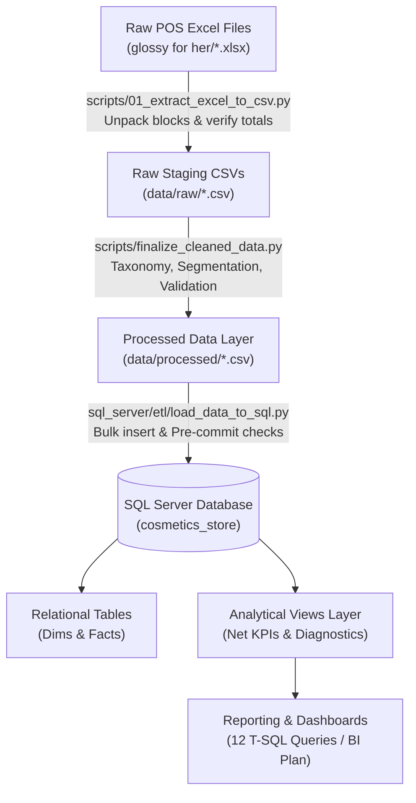
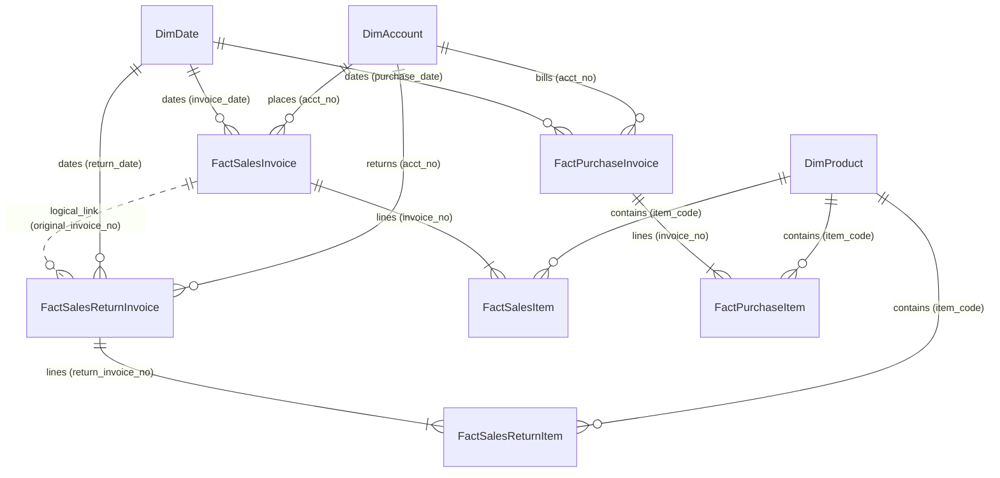
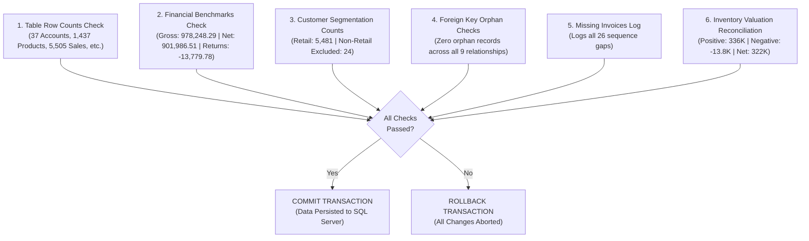

# System Analysis and Design
## Cosmetics Store Analytics & Business Intelligence
**Program:** Digital Egypt Pioneers Initiative (DEPI) — Data Analytics Track  
**Project:** Cosmetics Store Rebuild  
**Database:** Microsoft SQL Server (`cosmetics_store`)  
**Status:** Graduation Project Documentation (DEPI Data Analytics Track)  

---

## 1. Problem Statement and Objectives

### 1.1 Business Problem
The project analyzes the point-of-sale (POS) and inventory operations of an Egyptian retail cosmetics store over a 10-month trading period (28 Nov 2025 – 14 Sep 2026).
Before this project, the store faced several operational and analytical challenges:
- **No Consolidated Reporting:** Sales, purchases, and returns were recorded in separate transactional exports without unified relational reporting.
- **Why Are Sales Falling?:** Retail sales per trading day dropped severely from **≈5,150 EGP/day (Dec 2025) to ≈1,340 EGP/day (Aug 2026)**, a decline of nearly **74%**, while gross margin remained flat (≈21–22%). The owner had no reporting mechanism to understand if the drop was driven by fewer customers, smaller baskets, lower prices, or out-of-stock items.
- **Unstructured Product Catalog:** Over 1,400 raw product names lacked standardized departments, mixing beauty products with general merchandise, fashion items, and packaging bags.
- **Mixed Transactional Accounts:** Real retail shoppers, wholesale accounts, partner capital withdrawals, staff purchases, operational store expenses, and supplier cash settlements were stored indiscriminately in sales invoices.
- **Inflated Gross Revenue vs True Retail Revenue:** Standard accounting exports reported 978,248.29 EGP gross revenue, which included 24 non-retail invoices (62,482.00 EGP) representing partner withdrawals, supplier settlements, staff lines, and store expenses. True operational retail net sales was **901,987 EGP** (901,986.51 EGP) after deducting returns.
- **Inventory Assortment Collapse & Negative Stock:** 84 items displayed negative stock quantities (Assumed: possibly unrecorded supplier shipments or inventory timing gaps before purchase invoices were entered into the POS system), and active in-stock catalogue coverage plummeted from **98% to 63%**.
- **Financial Reconciliation Gaps:** Header totals and line-item totals required mathematical verification to ensure complete integrity across sales, purchases, returns, and inventory valuation before dashboard presentation.

### 1.2 Project Objectives
1. **End-to-End Reproducible Data Pipeline:** Build an automated extraction pipeline from raw POS Excel exports into flat CSVs with assertion checks, followed by text normalization and rule-based categorization.
2. **Relational Database Design & Implementation:** Deploy a normalized database in Microsoft SQL Server with primary keys, foreign keys, default constraints, performance indexes, and calendar dimensions.
3. **Core Analytics & Financial Reconciliation:** Provide exact mathematical reconciliation between Gross Book Revenue (978,248 EGP) and True Retail Net Revenue (901,987 EGP), Net Profit (192,534 EGP), and Net Margin (21.3%).
4. **Diagnostic Analysis (Root Cause of Sales Decline):** Write specialized diagnostic T-SQL queries and views proving that the 74% sales collapse was driven by a **65% drop in store footfall/traffic** caused by **assortment depletion and replenishment cessation**, rather than pricing or basket degradation.
5. **Business Intelligence Delivery (Dashboard Plan):** Formulate an actionable 5-view dashboard plan supporting management decision-making, performance tracking, and inventory restocking.

---

## 2. Requirements

### 2.1 Functional Requirements
- **FR-01 (Automated Extraction & Assertion):** Extract nested Excel blocks from POS files, unpack headers and line items, and enforce automated grand-total assertions (`assert`) against summary rows before creating raw CSVs.
- **FR-02 (Arabic Text Normalization):** Strip non-standard whitespace, clean diacritics, and standardize Arabic letters (`أ / إ / آ` → `ا`, `ى` → `ي`, and `ة` → `ه`).
- **FR-03 (Dual-Level Catalog Taxonomy):** Assign each product to a high-level `product_scope` (`In-Scope (Beauty)`, `In-Scope (Fashion)`, `Out-of-Scope (Personal Care)`, `Out-of-Scope (Packaging)`, or `Pending Review`) and a granular `product_category` (`Makeup & Cosmetics`, `Haircare`, `Fragrances & Deodorants`, `Skincare & Body`, `Accessories & Tools`, `Nail Care`, or `Uncategorized`) using whole-word token matching.
- **FR-04 (Account Classification & Retail Scope):** Classify all 37 accounts into verified roles (`Customer`, `Supplier`, `Partner/Capital Account`, `Staff/Payroll Account`, `Expense Account`, or `Other/Internal (Unclear)`). Automatically flag sales invoices with `is_retail_sale` (1 for Walk-in and Named Customer; 0 for Non-Retail transactions).
- **FR-05 (Relational Storage & Modeling):** Store data across dimension and fact tables in Microsoft SQL Server with foreign keys, a dynamic `DimDate` calendar table, and a `MissingInvoicesLog` tracking sequence gaps.
- **FR-06 (Analytical Views & Diagnostic Suite):** Provide analytical SQL views for net sales, monthly KPIs, category performance, ABC Pareto analysis, traffic vs ticket diagnostics, stock availability trends, and restock sales lift.

### 2.2 Non-Functional Requirements
- **NFR-01 (Mathematical Reconciliation & Accuracy):** Reconcile Gross Book Sales (978,248.29 EGP) and Retail Net Sales (901,986.51 EGP) down to the penny. Header totals must match line items exactly.
- **NFR-02 (Data Pipeline Reproducibility):** The entire pipeline must be runnable end-to-end via two scripts: `scripts/01_extract_excel_to_csv.py` and `scripts/finalize_cleaned_data.py`, followed by `sql_server/etl/load_data_to_sql.py`.
- **NFR-03 (Performance & Query Speed):** Nonclustered indexes on frequent filter keys (`invoice_date`, `is_retail_sale`, `acct_no`, `item_code`) ensure sub-second query response times.
- **NFR-04 (Integrity & Error Handling):** Database loader must wrap operations in an atomic transaction (`autocommit=False`) with automatic rollback on validation failure.
- **NFR-05 (Safe Calculations):** Prevent runtime division-by-zero errors in unit costs and margins using `NULLIF()` across all SQL queries and Python scripts.

---

## 3. System Architecture

The architecture consists of four distinct layers, ensuring clean separation of concerns:

### Layer Details:
1. **Raw Source Layer:** 6 Arabic POS Excel workbooks (`بيع.xlsx`, `شراء.xlsx`, `مرتجع بيع.xlsx`, `البضاعه.xlsx`, `الحسابات.xlsx`, `الارباح والخسائر.xlsx`).
2. **Extraction Layer (`01_extract_excel_to_csv.py`):** Unpacks repeating block structures (header → sub-header → lines → summary) and applies assertion tests before writing 8 flat CSVs to `data/raw/`:
   - `raw_sales_invoices.csv` (5,505 rows)
   - `raw_sales_items.csv` (10,891 rows)
   - `raw_purchase_invoices.csv` (32 rows)
   - `raw_purchase_items.csv` (1,658 rows)
   - `raw_sales_returns_invoices.csv` (127 rows)
   - `raw_sales_returns_items.csv` (157 rows)
   - `raw_products.csv` (1,437 rows)
   - `raw_accounts.csv` (37 rows)
3. **Processing & Taxonomy Layer (`finalize_cleaned_data.py`):** Normalizes Arabic text, applies the dual-level taxonomy (Scope & Category), isolates the 252 uncertain items review, segments customer accounts, flags non-retail invoices (`is_retail_sale`), protects unit cost division against zero, and exports synchronized datasets to `data/processed/`.
4. **Relational Database Layer (`cosmetics_store`):** Microsoft SQL Server database loaded via Python `pyodbc`, executing atomic transactions (`autocommit=False`), creating performance indexes, enforcing primary/foreign keys, and exposing analytical views.

---

## 4. Financial Reconciliation & Executive Scope

To resolve discrepancies between standard sales reports and retail operational figures, the project defines two transparent levels of revenue:

| Financial Metric | Invoices Count | Revenue (EGP) | Gross Profit (EGP) | Margin (%) | Description / Audit Rationale |
| :--- | :---: | :---: | :---: | :---: | :--- |
| **Gross Book Revenue** | **5,505** | **978,248.29** | **198,590.41** | **20.30%** | All transactional sales invoices exported from POS before any exclusions or returns. |
| *(Less)* Partner Capital Withdrawals | 3 | -47,682.00 | -2,609.29 | 5.47% | Account `احمد صبحي شريك` withdrawing inventory for personal/capital use (including bulk invoice #5328 of 47,207.00 EGP). |
| *(Less)* Supplier Settlements | 5 | -10,870.00 | +231.83 | -2.13% | Barter and goods settlements with suppliers (`احمد عبدالرازق نون`, `اجمل لمسة`). |
| *(Less)* Staff Purchases | 8 | -2,275.00 | -344.72 | 15.15% | Salary/payroll deduction accounts (`مريم`, `لميس`). |
| *(Less)* Store Operational Expenses | 3 | -325.00 | -40.01 | 12.31% | Petty cash expense account (`احمد عبدالرازق مصاريف`). |
| *(Less)* Other / Unclear Account | 5 | -1,330.00 | -274.03 | 20.60% | Internal personal account (`يوسف`). |
| **Total Non-Retail Excluded** | **24** | **-62,482.00** | **-3,036.22** | **4.86%** | **Total non-retail adjustments (`is_retail_sale = 0`).** |
| **Retail Gross Sales** | **5,481** | **915,766.29** | **195,554.19** | **21.35%** | Real retail revenue generated from walk-in shoppers and commercial buyers. |
| *(Less)* Sales Returns | 127 | -13,779.78 | -3,020.12 | 21.92% | Customer goods returned to store (all 127 returns are retail returns). |
| **RETAIL NET REVENUE** | **—** | **901,986.51** | **192,534.06** | **21.35%** | **Audited Net Operational Performance (~902K EGP).** |

> [!NOTE]
> The return rate against true Retail Gross Revenue is **1.50%** (13,779.78 / 915,766.29). Calculating returns against the unfiltered gross book figure yields an artificially deflated **1.41%**.

---

## 5. Account & Customer Segmentation

### 5.1 Account Nature Values
The raw `nature` values in `DimAccount` originate from the source accounting system in Arabic:

| Arabic Value (`nature`) | English Meaning | System Role |
| :--- | :--- | :--- |
| `عميل` | Customer | External individual or commercial buyers. |
| `مورد` | Supplier | External product vendors and distributors. |
| `أخرى` | Other / Internal | Partners, staff payroll, store expenses, or unassigned roles. |

### 5.2 Account Classification Breakdown
All 37 registered accounts in `DimAccount` have been classified with audited rationales:

| Account Classification | Nature (Source) | Count | Example Accounts | Internal Flag | Business Role / Audit Rationale |
| :--- | :---: | :---: | :--- | :---: | :--- |
| **Supplier** | مورد | 15 | الحافظ، الدكتور، شي ان السعوديه | 0 | External merchandise vendors. |
| **Customer** | عميل | 14 | ROKIA، حسين عبدالعظيم، محمود نسيم | 0 | Registered retail and commercial clients. |
| **Staff/Payroll Account** | أخرى / عميل | 3 | مريم، لميس، رقيه | 1 | Store employees (matched against P&L salary lines). |
| **Expense Account** | أخرى / عميل | 2 | مصاريف المحل، احمد عبدالرازق مصاريف | 1 | Operational petty cash and store expenses. |
| **Partner/Capital Account** | أخرى | 2 | احمد صبحي شريك، احمد عبدالرازق شريك | 1 | Store equity partners. |
| **Other/Internal (Unclear)** | أخرى | 1 | يوسف | 1 | Internal personal account without specified role. |

> [!IMPORTANT]
> In sales transactions, **5,417 out of 5,505 invoices (98.4%)** have `acct_no IS NULL` (Assumed: walk-in retail shoppers paying cash or card at the POS without creating a customer account).

---

## 6. Database Design and Data Modeling

### 6.1 Entity-Relationship (ER) Diagram
The database implements a star/snowflake-aligned schema centered around retail sales, purchases, returns, calendar dimensions, and sequence logs.

### 6.2 Physical Schema
The physical schema copied exactly from `02_create_tables_and_constraints.sql`:

#### 1. Dimension Tables

- **`dbo.DimAccount`**:
  - `acct_no int not null` → Primary Key (clustered)
  - `acct_name nvarchar(255) not null`
  - `nature nvarchar(50) not null`
  - `account_classification nvarchar(50) not null`
  - `classification_rationale nvarchar(255) null`
  - `is_internal bit not null constraint DF_DimAccount_is_internal default (0)`
  - `balance_debit decimal(18, 4) null`
  - `balance_credit decimal(18, 4) null`
  - `discount_pct decimal(18, 4) null`
  - `mobile nvarchar(50) null`
  - `address nvarchar(500) null`
  - `last_sale_date date null`
  - `last_sale_total decimal(18, 4) null`
  - `last_receipt_date date null`
  - `last_receipt_value decimal(18, 4) null`

- **`dbo.DimProduct`**:
  - `item_code int not null` → Primary Key (clustered)
  - `item_name nvarchar(500) not null`
  - `normalized_item_name nvarchar(500) null`
  - `product_scope nvarchar(100) not null`
  - `product_category nvarchar(100) not null`
  - `source_category nvarchar(100) null`
  - `total_qty decimal(18, 4) not null`
  - `unit nvarchar(50) null`
  - `sell_price decimal(18, 4) not null`
  - `avg_purchase_price decimal(18, 4) not null`
  - `last_purchase_price decimal(18, 4) not null`
  - `barcode nvarchar(100) null`
  - `item_code_1_MISLABELED nvarchar(100) null`
  - `stock_cost_valuation decimal(18, 4) not null`
  - `is_out_of_stock bit not null constraint DF_DimProduct_is_out_of_stock default (0)`

- **`dbo.DimDate`**:
  - `date_key int not null` → Primary Key (clustered)
  - `full_date date not null`
  - `[year] int not null`
  - `[quarter] int not null`
  - `[month] int not null`
  - `year_month char(7) not null`
  - `month_name nvarchar(20) not null`
  - `days_in_month int not null`
  - `iso_week int not null`
  - `weekday_no int not null`
  - `weekday_name nvarchar(20) not null`
  - `is_weekend bit not null`

- **`dbo.MissingInvoicesLog`**:
  - `missing_invoice_no int not null` → Primary Key (clustered)
  - `gap_after_invoice int not null`
  - `gap_before_invoice int not null`
  - `detected_at datetime not null default getdate()`

#### 2. Fact Tables

- **`dbo.FactSalesInvoice`**:
  - `invoice_no int not null` → Primary Key (clustered)
  - `counter int null`
  - `invoice_date date not null`
  - `order_time time null`
  - `order_hour int null`
  - `order_year int null`
  - `order_month int null`
  - `order_day_name nvarchar(20) null`
  - `is_weekend bit not null constraint DF_FactSalesInvoice_is_weekend default (0)`
  - `acct_no int null` → Foreign Key references `DimAccount(acct_no)`
  - `account_name nvarchar(255) null`
  - `customer_account_classification nvarchar(50) not null`
  - `sale_type nvarchar(50) not null`
  - `internal_account_status nvarchar(20) not null constraint DF_FactSalesInvoice_internal_status default ('none')`
  - `is_internal_account bit not null constraint DF_FactSalesInvoice_is_internal default (0)`
  - `is_retail_sale bit not null constraint DF_FactSalesInvoice_is_retail default (1)`
  - `payment_method nvarchar(50) null`
  - `total_qty decimal(18, 4) not null`
  - `total_discount decimal(18, 4) not null constraint DF_FactSalesInvoice_total_discount default (0)`
  - `final_total decimal(18, 4) not null`
  - `profit decimal(18, 4) not null`
  - `cash_drawer decimal(18, 4) null`
  - `credit_card decimal(18, 4) null`
  - `treasury decimal(18, 4) null`
  - `paid_cash decimal(18, 4) null`
  - `deferred decimal(18, 4) null`
  - `due decimal(18, 4) null`
  - `warehouse nvarchar(100) null`
  - `sales_rep nvarchar(100) null`
  - `added_by nvarchar(100) null`
  - `added_time time null`
  - `modified_by nvarchar(100) null`
  - `modified_time time null`

- **`dbo.FactSalesItem`**:
  - `sales_item_id int identity(1, 1) not null` → Primary Key (clustered)
  - `invoice_no int not null` → Foreign Key references `FactSalesInvoice(invoice_no)`
  - `invoice_row_index int null`
  - `item_code int not null` → Foreign Key references `DimProduct(item_code)`
  - `item_name nvarchar(500) not null`
  - `available_qty decimal(18, 4) null`
  - `qty decimal(18, 4) not null`
  - `price decimal(18, 4) not null`
  - `discount decimal(18, 4) not null constraint DF_FactSalesItem_discount default (0)`
  - `profit decimal(18, 4) not null`
  - `line_final decimal(18, 4) not null`
  - `unit_cost decimal(18, 4) not null constraint DF_FactSalesItem_unit_cost default (0)`

- **`dbo.FactPurchaseInvoice`**:
  - `invoice_no int not null` → Primary Key (clustered)
  - `counter int null`
  - `purchase_date date not null`
  - `purchase_time time null`
  - `acct_no int null` → Foreign Key references `DimAccount(acct_no)`
  - `account_name nvarchar(255) null`
  - `payment_method nvarchar(50) null`
  - `total_qty decimal(18, 4) not null`
  - `total_discount decimal(18, 4) not null constraint DF_FactPurchaseInvoice_total_discount default (0)`
  - `final_total decimal(18, 4) not null`
  - `cash_drawer decimal(18, 4) null`
  - `credit_card decimal(18, 4) null`
  - `treasury decimal(18, 4) null`
  - `paid_cash decimal(18, 4) null`
  - `deferred decimal(18, 4) null`
  - `due decimal(18, 4) null`
  - `warehouse nvarchar(100) null`
  - `added_by nvarchar(100) null`
  - `added_time time null`
  - `modified_by nvarchar(100) null`
  - `modified_time time null`

- **`dbo.FactPurchaseItem`**:
  - `purchase_item_id int identity(1, 1) not null` → Primary Key (clustered)
  - `invoice_no int not null` → Foreign Key references `FactPurchaseInvoice(invoice_no)`
  - `invoice_row_index int null`
  - `item_code int not null` → Foreign Key references `DimProduct(item_code)`
  - `item_name nvarchar(500) not null`
  - `available_qty decimal(18, 4) null`
  - `qty decimal(18, 4) not null`
  - `price decimal(18, 4) not null`
  - `discount decimal(18, 4) not null constraint DF_FactPurchaseItem_discount default (0)`
  - `line_final decimal(18, 4) not null`

- **`dbo.FactSalesReturnInvoice`**:
  - `return_invoice_no int not null` → Primary Key (clustered)
  - `counter int null`
  - `return_date date not null`
  - `return_time time null`
  - `return_year int null`
  - `return_month int null`
  - `return_day_name nvarchar(20) null`
  - `original_invoice_no int null` → (Logical reference, not an enforced FK)
  - `original_invoice_status nvarchar(100) not null`
  - `is_linked_to_sales bit not null constraint DF_FactSalesReturnInvoice_is_linked default (1)`
  - `is_retail_sale bit not null constraint DF_FactSalesReturnInvoice_is_retail default (1)`
  - `acct_no int null` → Foreign Key references `DimAccount(acct_no)`
  - `account_name nvarchar(255) null`
  - `payment_method nvarchar(50) null`
  - `total_qty decimal(18, 4) not null`
  - `total_discount decimal(18, 4) not null constraint DF_FactSalesReturnInvoice_total_discount default (0)`
  - `final_total decimal(18, 4) not null`
  - `profit decimal(18, 4) not null`
  - `cash_drawer decimal(18, 4) null`
  - `credit_card decimal(18, 4) null`
  - `treasury decimal(18, 4) null`
  - `paid_cash decimal(18, 4) null`
  - `deferred decimal(18, 4) null`
  - `due decimal(18, 4) null`
  - `warehouse nvarchar(100) null`
  - `sales_rep nvarchar(100) null`
  - `added_by nvarchar(100) null`
  - `added_time time null`
  - `modified_by nvarchar(100) null`
  - `modified_time time null`

- **`dbo.FactSalesReturnItem`**:
  - `return_item_id int identity(1, 1) not null` → Primary Key (clustered)
  - `return_invoice_no int not null` → Foreign Key references `FactSalesReturnInvoice(return_invoice_no)`
  - `invoice_row_index int null`
  - `item_code int not null` → Foreign Key references `DimProduct(item_code)`
  - `item_name nvarchar(500) not null`
  - `available_qty decimal(18, 4) null`
  - `qty decimal(18, 4) not null`
  - `price decimal(18, 4) not null`
  - `discount decimal(18, 4) not null constraint DF_FactSalesReturnItem_discount default (0)`
  - `profit decimal(18, 4) not null`
  - `line_final decimal(18, 4) not null`

### 6.3 Normalization & Intentional Design Decisions
Rather than claiming complete Third Normal Form (3NF), the schema balances relational rigor with analytical query performance:
1. **Dimensions are Close to 3NF:**
   - Most attributes depend solely on the primary key (`item_code` or `acct_no`).
   - **Exceptions (Derived Attributes):** `DimProduct` stores derived catalog metrics (`avg_purchase_price`, `stock_cost_valuation`, `is_out_of_stock`), and `DimAccount` retains ledger balances (`balance_debit`, `balance_credit`, `last_sale_total`). These pre-computed attributes exist to avoid recalculating total inventory valuation and customer balances across thousands of transactional rows on every query.
2. **Intentional Denormalization on Fact Tables:**
   - **Repeated Names:** `item_name` is duplicated in sales/purchase line items, and `account_name` is duplicated on invoice headers. This allows self-contained reporting if an account or item name changes historically in the master catalog.
   - **Derived Invoice Totals:** `final_total`, `profit`, `total_qty`, and `total_discount` are stored directly on headers to enable instant aggregations without joining child line tables.
   - **Derived Date Parts:** `order_hour`, `order_year`, `order_month`, `order_day_name`, and `is_weekend` are stored directly on `FactSalesInvoice` to accelerate time-series queries and avoid repeated function calls in `GROUP BY` clauses.
3. **Logical Reference for Returns (`original_invoice_no`):**
   - In `FactSalesReturnInvoice`, `original_invoice_no` is maintained as a logical reference rather than an enforced foreign key constraint. This design choice is necessitated by data facts:
     - Return #102 has `original_invoice_no = 0` (Assumed: placeholder for cash register refund without receipt).
     - Returns #125, #126, and #127 reference invoices #5532, #5543, and #5567 created in September 2026, which occurred after the cutoff date of the sales invoice file (#5531 on 2026-09-02).
     - An enforced SQL foreign key would have rejected these valid return records during data loading.

---

## 7. Diagnostic Analysis: Why Did Sales Fall?

To answer the business owner's primary question (*"Why did retail sales decline by 74% from Dec 2025 to Aug 2026?"*), the project deployed specialized diagnostic queries and views:

### 7.1 Finding 1: A Footfall (Traffic) Problem, Not Pricing or Basket Size
Decomposing sales into **Daily Invoices (Traffic)** vs **Average Ticket Value (Basket)** vs **Unit Price**:

| Metric | Dec 2025 (Peak Baseline) | Aug 2026 (Trough) | Variance (%) | Strategic Interpretation |
| :--- | :---: | :---: | :---: | :--- |
| **Invoices / Trading Day (Traffic)** | **29.3** | **10.2** | **−65.2%** | **Primary driver:** 65% fewer customers visited the store. |
| **Average Ticket (AOV)** | **179.1 EGP** | **132.6 EGP** | **−26.0%** | Basket value contracted slightly due to fewer units. |
| **Basket Size (Units / Invoice)** | **2.46** | **1.80** | **−26.8%** | Shoppers bought fewer items per visit. |
| **Average Unit Selling Price** | **72.9 EGP** | **73.7 EGP** | **+1.1% (Flat)** | **Prices did not change; store did not suffer price erosion.** |
| **Distinct SKUs Sold / Month** | **628** | **314** | **−50.0%** | Half the assortment stopped generating sales. |

$$\text{Contribution of Traffic Collapse to Sales Drop} \approx \mathbf{78\%}$$

### 7.2 Finding 2: Inventory Assortment Collapse (Stock Depletion)
The footfall collapse was directly caused by the store **halting stock replenishment**:
- **Purchased Units:** 11,536 units in Nov 2025 (opening inventory) → 2,865 units in Dec → 586 in March → **25 in June → 3 in August 2026**.
- **Catalogue Availability:** Share of active catalogue in stock plunged from **97.9% (Nov 2025) to 63.8% (Aug 2026)**. By September 2026, **528 out of 1,424 SKUs (37%)** were completely out of stock or negative.
- **Top Sellers Depleted:** 76 of the top-100 revenue-generating products from Dec–Jan had $\le 2$ units remaining by August, causing customers to leave empty-handed.

### 7.3 Finding 3: Restock Natural Experiment (Sales Lift)
Whenever the store restocked $\ge 20$ products in a purchase order, revenue for those restocked items jumped substantially in the 45 days following replenishment compared to the 45 days prior:
- **Restock Event 2026-02-26 (75 SKUs):** Sales lift = **+107.5%**
- **Restock Event 2026-03-19 (90 SKUs):** Sales lift = **+77.9%**
- **Restock Event 2026-04-25 (143 SKUs):** Sales lift = **+128.9%**

This proves empirically that customer demand existed, and whenever inventory was replenished, sales rebounded immediately.

---

## 8. Technology Stack

### 8.1 Tools Used in the Project
- **Python 3.11+:**
  - `pandas`: Tabular extraction, assertion validation, text cleaning, taxonomy assignment.
  - `numpy`: Numerical calculations and missing-value handling.
  - `pyodbc`: Programmatic transactional connection and batch loading (`fast_executemany = True`) into Microsoft SQL Server.
  - `openpyxl`: Ingestion of nested `.xlsx` spreadsheets.
  - `matplotlib` & `seaborn`: Visualization generation in Jupyter Notebook.
  - `jupyter`: Interactive analysis, defense documentation, and metric tie-outs.
- **Database Engine:**
  - `Microsoft SQL Server 2019 / 2022 / Express`: Relational storage, referential integrity, performance indexing, and views.
  - `SQL Server Management Studio (SSMS)`: Database administration, query authoring, execution plan analysis.
- **Querying & Modeling:**
  - `T-SQL`: Window functions (`dense_rank`, `sum() over`), Common Table Expressions (CTEs), calendar logic, and diagnostic views.

### 8.2 Planned / Dashboard Tools
- **Power BI / Tableau / Streamlit:** Planned for interactive executive reporting and visual dashboard delivery based on the views defined in Section 9. (No working `.pbix` or `.twb` files are currently part of the backend repository).

---

## 9. Business Intelligence Delivery (Dashboard Plan)

The dashboard delivery is structured as a **Plan** containing 5 specialized analytical views:

### View 1: Executive KPI & Revenue Summary
- **Purpose:** Track high-level business performance, trading days, and revenue trends over time.
- **Key Metrics:** Retail Gross Sales, Sales Returns, Retail Net Sales (901,987 EGP), Net Profit (192,534 EGP), Net Margin % (21.35%), and Average Ticket Value.
- **Visuals:** Monthly revenue and profit dual-axis bar chart, daily sales run rate, and partial month indicators (Nov 2025 and Sep 2026).

### View 2: Customer & Account Segmentation
- **Purpose:** Provide transparency into walk-in shoppers vs commercial accounts, and audit non-retail transactions.
- **Key Metrics:** Walk-in cash volume (5,417 orders, 859.5K EGP), commercial customer volume (64 orders, 56.2K EGP), and excluded transactions (24 orders, 62.5K EGP).
- **Visuals:** Transaction type breakdown bar chart, RFM segmentation table for registered clients, and sensitivity waterfall chart.

### View 3: Category Performance & Assortment Margins
- **Purpose:** Evaluate department contribution, beauty scope vs non-beauty, and category profitability.
- **Key Metrics:** Revenue contribution %, profit margin %, and average unit selling price by category.
- **Visuals:** Horizontal bar chart of department revenues, category profit margin comparison, and Pareto 80/20 product ranking.

### View 4: Inventory Health, Stockout Alerts & Restock Lift
- **Purpose:** Monitor catalogue availability, dead stock capital, negative inventory, and replenishment impact.
- **Key Metrics:** In-stock availability % (monthly trend), positive stock valuation (336K EGP), negative stock impact (-13.8K EGP), net valuation (322K EGP), and restock sales lift %.
- **Visuals:** Catalogue availability depletion line chart, top-100 sellers stockout tracker, and pre/post 45-day restock lift comparison bars.

### View 5: Operating Cycles & Hourly Shopping Behavior
- **Purpose:** Optimize staff scheduling and store opening hours based on customer shopping patterns.
- **Key Metrics:** Friday revenue share (22.41%), late-night shift volume (20:00 to 03:59 represents 67.20% of sales), and hourly ticket size.
- **Visuals:** 24-hour revenue histogram, weekday revenue comparison with Friday highlighted, and shift distribution pie chart.

---

## 10. Testing, Validation, and Data Quality Checks

> [!IMPORTANT]
> The database has **no CHECK or UNIQUE constraints** defined at the SQL DDL level. Instead, data quality and integrity are strictly enforced during the Python data cleaning step and verified via pre-commit validation tests in `sql_server/etl/load_data_to_sql.py`.

The database loader wraps all operations in an atomic transaction (`autocommit=False`) and executes 6 pre-commit validation checks before persisting data:

### Verified Checks in Code:
1. **Row Count Verification:** Matches source CSV counts (37 accounts, 1,437 products, 5,505 sales invoices, 10,891 sales items, 32 purchase invoices, 1,658 purchase items, 127 return invoices, 157 return items).
2. **Financial Tie-Out:** Verifies Gross Sales (978,248.29 EGP), Excluded Non-Retail (62,482.00 EGP), Retail Gross Sales (915,766.29 EGP), Sales Returns (-13,779.78 EGP), Retail Net Sales (901,986.51 EGP), and Purchases Total (1,118,614.71 EGP).
3. **Foreign Key Integrity:** Verifies zero orphan records across all 9 relational links between facts and dimensions.
4. **Missing Sequence Logging:** Detects and logs all 26 missing sales invoice numbers in `MissingInvoicesLog`.

---

## 11. Known Data Limitations

1. **No DimDate Table in Source Data:** Raw POS exports contained timestamps but no calendar dimension table. `DimDate` was programmatically generated during ETL.
2. **No Customer Identity for 98.4% of Invoices:** 5,417 out of 5,505 sales invoices are walk-in cash transactions without a customer name or account number (`acct_no IS NULL`). True customer retention, lifetime value (LTV), and churn rates cannot be computed across the customer base.
3. **Four Unlinked Sales Returns:**
   - Return #102 has `original_invoice_no = 0` (Assumed: cash register placeholder value for refund without receipt).
   - Returns #125, #126, and #127 reference invoices #5532, #5543, and #5567 from September 2026. (Assumed: these transactions occurred after the cutoff date of the sales invoice file on 2026-09-02).
   - Consequently, `original_invoice_no` is modeled as a logical reference and not an enforced foreign key.
4. **No CHECK or UNIQUE Constraints in Database:** The physical schema relies on Python validation rather than SQL engine constraints.
5. **Empty Sales Rep Column:** The `sales_rep` column is 100% empty (NULL) across all sales invoices in the raw data, preventing commission or staff sales performance analysis.
6. **Gross Profit vs Net Operating Profit:** Recorded profit represents gross margin (Revenue − Unit Cost) and does not deduct operating expenses (rent, utilities, salaries, marketing).
7. **84 Negative Stock Products:** 84 products show negative stock balances in `DimProduct`. (Assumed: possibly merchandise received and sold to customers before supplier purchase invoices were logged into the POS system).
8. **26 Missing Sales Invoice Numbers:** 26 numbers are missing from the chronological invoice sequence (e.g., invoices #175, #744, #1233), recorded in `MissingInvoicesLog`. (Assumed: voided transactions or POS register restarts).
9. **Partial Operating Months:** November 2025 (trading started Nov 28) and September 2026 (trading captured through Sep 14) are partial trading months and are dynamically flagged in `vw_KpiMonthly`.
10. **Absence of Prior-Year Data:** Because data is limited to a single 10-month window, seasonality (such as Ramadan and Eid spikes) cannot be mathematically isolated from macro-economic decline trends.
